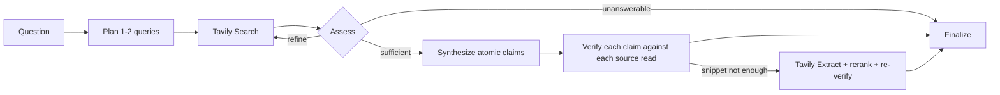

# Groundmark

**A live-web research agent that shows, claim by claim, whether its sources actually say what the answer says.**

Built for the ODSC × Nebius hackathon challenge *Build a research agent that brings its sources*.

- **Demo video (2–3 min):** _link added after upload_
- **Team:** Flare Tensor ([@flaretensor](https://github.com/flaretensor)), solo

## The problem

A cited answer looks trustworthy, but a link next to a sentence doesn't mean the page says what the sentence says. Numbers drift between a city and its metro area, a fiscal and a calendar year, or a total and an annual change. Checking every link by hand is slow.

Groundmark is for anyone who needs a current fact they can check before using it: an analyst pulling the latest quarterly figure, a reporter confirming a statistic, a student verifying a number for a paper. It searches the live web, breaks its answer into short claims, and checks each claim against the retrieved text. Only claims that pass the check make it into the answer. Everything else is shown as a conflict or a gap, never hidden.

## Example

**Question:** Who won the 2026 Nobel Prize in Physics, and for what?

**Answer:**

> The Royal Swedish Academy of Sciences awarded the Nobel Prize in Physics 2026 to Francis Halzen of the University of Wisconsin–Madison, USA, announced on 6 October 2026. [1] [2]

The second claim gives the prize citation, quoted from the Nobel press release. Each number links to its source page. Open a claim under **Claims** to see each source's verdict, the verbatim quote the checker relied on and a one-sentence reason. All seven sources read for this answer came from nobelprize.org or the Nobel Prize YouTube channel.

**When sources disagree:** *What is the latest stable release of Python?* Python.org's download page and home page name 3.15.2 as the latest release. Two other pages disagree: a python.org source-releases page, served as a no-script fallback, that listed 3.15.1, and an older article written while 3.15 was still a release candidate. Groundmark marked "the latest stable release is 3.15.2" as **Sources disagree** and kept it out of the answer. The answer kept only the two supported claims, the 3.15.2 and 3.15.0 release dates.

**Failure case:** *What revenue did Apple report for its fiscal 2027 first quarter?* Apple's fiscal first quarter runs from October to December, so on November 20, 2026 it hadn't been reported. The agent ran one search round, found older first-quarter results and a page expecting the next report in late January 2027, and stopped: "This can't be known yet as of today's date." It skipped synthesis and made no claims instead of reporting an earlier quarter's revenue.

| Run | Outcome | Time | Tavily credits | Estimated Nebius cost |
|---|---|---:|---:|---:|
| 2026 Nobel Prize in Physics | 2 supported claims, 1 search round | 13.0 s | 2 | $0.009 |
| Latest stable Python release | 2 supported claims, 1 conflicting claim, 1 round | 16.7 s | 2 | $0.011 |
| Apple fiscal 2027 first-quarter revenue | Abstained after 1 round | 4.4 s | 2 | $0.0015 |
| 2030 Nobel Prize in Physics | Abstained after 1 round | 3.1 s | 1 | $0.0008 |
| 2027 Wimbledon men's singles title | Abstained after 1 round | 4.6 s | 2 | $0.0014 |
| NVIDIA's most recent quarterly data center revenue | 1 supported claim, 1 round. NVIDIA's own release was read, but its snippet lacked the 21% sequential growth in the claim, so other sources carried it | 17.2 s | 2 | $0.012 |
| Microsoft's most recent quarterly revenue | 2 supported claims, 1 round. The revenue figure was supported only by an aggregator's company profile | 16.5 s | 2 | $0.009 |

These are all seven live runs made on November 20, 2026 after the last change to the agent, recorded to show behavior. They aren't an accuracy benchmark.

## How it works



The agent is a LangGraph `StateGraph`. Planning, assessment, synthesis and verification run on `nvidia/Nemotron-3.5-Super-VL` through Nebius Token Factory, and each step returns a strict Pydantic schema.

1. **Plan.** Writes one or two search queries. The current date turns "latest" or "this year" into explicit years.
2. **Search.** Tavily Search (basic, 5 results per query). Results are deduplicated by canonical URL or content hash and get stable IDs (`S1`, `S2`, …) that the model must cite exactly. The UI renumbers sources 1, 2, 3 in the order the answer cites them.
3. **Assess.** Decides whether the sources answer the question for the right entity, place and period. It can run one focused follow-up search (at most two rounds), or stop when the answer can't exist yet.
4. **Synthesize.** Writes up to six short, atomic claims from up to ten sources. Each claim carries its scope and period, and disagreements and gaps are recorded explicitly.
5. **Verify.** Checks every claim against every source the answer was written from, in parallel. Each pair gets `supported`, `contradicted` or `not_supported`, plus a verbatim quote of at most 300 characters. If the quote can't be found in the source text, the verdict is downgraded to `not_supported`.
6. **Extract fallback.** When a claim isn't supported by its search snippet, Tavily Extract fetches the cited page. Groundmark splits it into chunks, picks candidates with `Qwen/Qwen3-Embedding-8B` on Nebius, reranks them on CPU with a cross-encoder (in Docker), and checks again.
7. **Finalize.** The answer is built only from supported claims. A claim with both support and contradiction is `conflicting`. `not_supported` means the retrieved text doesn't prove the claim, not that the claim is false.

**Safety.** Web content is passed to the model as untrusted data blocks, and prompts tell the model to ignore instructions inside them. Secrets are redacted from questions, and URLs that contain secrets are dropped. The model is told not to output URLs or HTML, and any source ID it invents is stripped. The UI escapes web text so a page can't inject Markdown.

**Cost control.** Each call reserves a pessimistic estimate in an append-only ledger before it runs, then records actual usage. Default limits are 6 Tavily credits and $0.15 per run, and 1,000 credits and $5 in total. If search credits run out, the agent still answers from the sources it already has. These are software estimates, not provider invoices or spending caps.

## Required services

| Service | How Groundmark uses it |
|---|---|
| Nebius Token Factory | `nvidia/Nemotron-3.5-Super-VL` plans, assesses, synthesizes and verifies. `Qwen/Qwen3-Embedding-8B` ranks page chunks in the Extract fallback. |
| Tavily | Search finds live sources, and Extract fetches full pages when snippets are too short. Every source keeps its URL, dates and `S#` ID from search through the final answer. |

## Run it

You need a Nebius Token Factory API key and a Tavily API key.

```bash
git clone https://github.com/flaretensor/groundmark
cd groundmark
cp .env.example .env    # add NEBIUS_API_KEY and TAVILY_API_KEY; .env is git-ignored
```

**Docker Compose (recommended).** This starts the API, the Streamlit UI, Postgres for LangGraph checkpoints and MLflow for traces. It also turns on the CPU reranker, which is off by default elsewhere.

```bash
scripts/compose.sh up               # add --monitoring for Prometheus and Grafana
# UI http://127.0.0.1:8601 · API http://127.0.0.1:8100 · MLflow http://127.0.0.1:5100
scripts/compose.sh down
```

If a default port is taken, the script picks the next free one and writes it to `.cache/compose-ports.env`.

**Local with uv** (Python 3.13). Checkpoints go to SQLite and the reranker is off.

```bash
uv sync
uv run groundmark ask "Who won the 2026 Nobel Prize in Physics, and for what?"
uv run streamlit run src/groundmark/ui.py
uv run groundmark report            # DuckDB summary of past runs
```

**Organizer entry point** (Python 3.13):

```bash
python -m venv .venv && source .venv/bin/activate
pip install -r requirements.txt
python src/agent.py "Your research question"
```

**Other interfaces:**
- `uv run uvicorn groundmark.api:app` serves `POST /research`, `POST /research/stream` (server-sent events), `/health` and `/metrics`.
- `uv run groundmark-mcp` exposes a `research` tool over MCP stdio.

## Trace and observability

Every run has a `run_id` and a redacted trace. In the UI, the **Search details** tab shows each round's queries and the agent's decision, stage timings and usage, and has a button to download the full trace as JSON. The trace holds:
- the queries, assessment decisions and stop reason;
- per-stage latency and OpenTelemetry spans;
- token counts, including reasoning tokens;
- Tavily credits and estimated cost.

API keys, hidden reasoning and full page text never go into the trace. In Docker, spans are exported to MLflow. Each run also appends a row to local Parquet files, which `groundmark report` summarizes with DuckDB (status counts, p50/p95 latency, credits, cost). An optional Prometheus and Grafana profile shows the live metrics.

## Limitations

- **The checker is a model.** The same model writes and checks the claims. A verdict is the model's judgment plus a literal quote match, not proof. In an earlier Tokyo population run the answer matched the official source it cited: the Tokyo Metropolitan Government figure of 14.273 million as of October 1, 2025, plus the urban-area estimate, each labeled with its scope. But the cross-check flagged a prefecture figure as contradicting a city-proper figure, and it accepted a low-quality page's claim of 37.8 million as a contradiction. Both mistakes ended up under **Conflicts**, not in the answer, and both are scope errors.
- **Source quality isn't scored.** The prompts prefer official sources, but nothing in the code ranks sources by authority. Tavily's relevance score isn't a reliability score. In the NVIDIA run a Reddit post was cited next to filings coverage, and in the Microsoft run an aggregator profile was the only support for the revenue figure.
- **Claims aren't always atomic.** In the NVIDIA run the model packed revenue, period and two growth rates into one claim, so a source that confirmed only part of it didn't count as support.
- **Only sources read for the answer are checked.** That's up to ten per run. Other retrieved results are listed but not verified.
- **Snippets lose structure.** Tables and infoboxes arrive flattened, so a number can lose its label.
- **No accuracy benchmark yet.** The runs above are examples, not measured accuracy.
- **One run at a time.** The API serves one run at a time. There's no conversational follow-up and no resume after a crash, even though checkpoints are saved.
- **The web changes.** Answers depend on what the web says when you ask. The optional replay cache is keyed by query only.

## What's next

- Train a small, separate verifier on licensed, human-labeled claim-evidence data, so the model that writes the answer doesn't grade itself.
- Evaluate on a fixed question set against a single-search baseline using frozen evidence: answer support, abstention, conflicts, latency and cost.
- Store claim-level results (claim, source, verdict, model, configuration) for error analysis.

## Judging criteria map

| Criterion | Weight | Where to look |
|---|---|---|
| Sourced and verifiable answers | 30% | [Example](#example), the claim checks in the demo, [Limitations](#limitations) |
| Works end to end | 25% | [Run it](#run-it), demo video |
| Usefulness | 20% | [The problem](#the-problem) |
| Agent design | 15% | [How it works](#how-it-works), [Trace and observability](#trace-and-observability) |
| Use of Token Factory and Tavily | 10% | [Required services](#required-services) |

## License

Groundmark's code is released under the [MIT License](LICENSE). Models, web pages and API services are subject to their own terms. Groundmark isn't affiliated with NVIDIA, Nebius, Tavily or ODSC.
